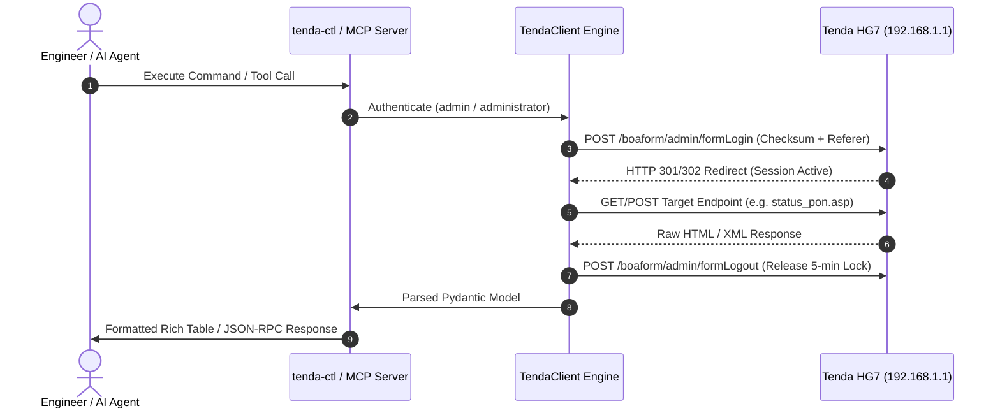

<p align="center">
  
</p>

<h1 align="center">SLT Fiber Tenda HG7 Router Controller</h1>

<p align="center">
  Autonomous AI agent control ecosystem, FastMCP server, and CLI management utility for Tenda HG7 GPON ONT routers deployed on Sri Lanka Telecom (SLT-MOBITEL) fiber optic broadband.
</p>

<p align="center">
  <a href="#"></a>
  <a href="#"></a>
  <a href="#"></a>
  <a href="#"></a>
  <a href="LICENSE"></a>
</p>

<p align="center">
  <a href="#overview">Overview</a> &bull;
  <a href="#architecture--role-privileges">Architecture</a> &bull;
  <a href="#project-structure">Structure</a> &bull;
  <a href="#installation">Installation</a> &bull;
  <a href="#tool-catalog--usage">Tools & Usage</a> &bull;
  <a href="#super-admin-inspection">Super Admin</a> &bull;
  <a href="#model-context-protocol-server">MCP Server</a> &bull;
  <a href="#verification-tests">Testing</a> &bull;
  <a href="#security--isp-safety-boundaries">Security</a> &bull;
  <a href="#license">License</a>
</p>

## Overview

The **SLT Fiber Tenda HG7 Controller** provides programmatic automation and autonomous agent integration for the Tenda HG7 Dual-Band AC1200 GPON ONT router deployed across Sri Lanka Telecom (SLT-MOBITEL) fiber optic broadband lines. Built on a Realtek RTL960x SoC running the embedded Boa 0.95.15 web server accessible at [http://192.168.1.1](http://192.168.1.1), the router normally requires manual web dashboard interactions, lacks an official REST API, and locks out concurrent administrator sessions.

This project delivers:
- **Autonomous Agent Control via MCP**: A standards-compliant Model Context Protocol server exposing 12 structured tools for optical telemetry, device inventories, diagnostic ping, Wi-Fi mutations, WAN profiles, VoIP SIP status, and TR-069 configuration to AI assistants (Google Antigravity, Claude, Cursor).
- **Engineering CLI (`tenda-ctl`)**: Global command-line interface with formatted terminal tables for network administrators and engineers.
- **Dual-Role Architecture**: Transparent support for both standard end-user (`admin`) and ISP Super Administrator (`administrator`) privilege levels with dynamic role detection.
- **Protocol Emulation Engine**: Reverse-engineered implementation of Realtek's 32-bit checksum algorithm (`postTableEncrypt`), automatic session lifecycle teardown, and base64 passphrase encryption.
- **Strict ISP Safety Protections**: Hardcoded write-protection guardrails that prevent accidental modification of SLT WAN VLANs (VLAN 20 Internet PPPoE, VLAN 10 Voice IPoE, VLAN 30 PeoTV) or optical registration states.

## Architecture & Role Privileges

The embedded web server dynamically binds client sessions to distinct JavaScript menus based on the authenticated credentials.

| Feature / Subsystem | Standard Admin (`admin`) | Super Admin (`administrator`) | Technical Details |
| :--- | :--- | :--- | :--- |
| **Active Interface Script** | `admin/userMenu.js` | `adminMenu.js` | Embedded Boa server binds menu script per IP session. |
| **Top-Level Navigation** | 8 Modules | 10 Modules | Unlocks **WAN** (Sub 4) and **VoIP** (Sub 6). |
| **Broadband WAN Profiles** | Hidden | Full Inspection | VLAN 20 Internet PPPoE, VLAN 10 Voice IPoE, VLAN 30 PeoTV. |
| **Landline VoIP Telephony** | Hidden | Full Inspection | SIP Proxy (`ftth.sltims.lk:5060`), Domain, RTP port 5000. |
| **Access Control Lists (ACL)** | Hidden | Full Inspection | Management access rules for Telnet, SSH, HTTP, HTTPS, ICMP. |
| **TR-069 CWMP Management** | Hidden | Full Inspection | SLT ACS URL (`http://acs.slt.lk`), inform interval, credentials. |
| **Port Mirroring** | Hidden | Full Inspection | Frame mirroring to monitor port for packet analysis. |
| **WLAN, DHCP, Firewall** | Accessible | Accessible | Wi-Fi SSIDs, passphrases, MAC filtering, port forwarding. |



## Project Structure

```
.
├── assets/
│   ├── screenshots/               # Sanitized terminal outputs (help, status, pon)
│   └── tenda-logo.png             # Optimized official transparent logo
├── docs/
│   ├── api-reference.md           # Python client methods and schemas
│   ├── endpoints-map.md           # Complete 44-page router endpoint mapping
│   └── super-admin-guide.md       # Technical guide to Super Admin subsystems
├── tenda_controller/
│   ├── __init__.py                # Package exports and version metadata
│   ├── client.py                  # HTTP client, checksum, and session engine
│   ├── cli.py                     # Rich command-line interface (tenda-ctl)
│   ├── exceptions.py              # Domain error types and safety guardrails
│   ├── mcp_server.py              # FastMCP server for AI agent tool calling
│   └── models.py                  # Pydantic schemas for router telemetry
├── tests/
│   ├── __init__.py
│   ├── test_checksum.py           # Verification of Realtek checksum vectors
│   ├── test_client_mock.py        # Mock unit tests for basic client parsers
│   └── test_super_admin_mock.py   # Mock unit tests for Super Admin parsers
├── .env.example                   # Environment configuration template
├── CODE_OF_CONDUCT.md             # Contributor Covenant Code of Conduct v2.1
├── CONTRIBUTING.md                # Development, testing, and PR guidelines
├── install.sh                     # Turnkey system installer script
├── LICENSE                        # MIT License
├── pyproject.toml                 # Build configuration (setuptools)
├── README.md                      # Project documentation
├── requirements.txt               # Pinned runtime dependencies
└── SECURITY.md                    # Security advisories and disclosure policy
```

## Installation

### Method 1: Turnkey One-Line Installer (Recommended)
Clone the repository and run the automated installer script:
```bash
git clone https://github.com/dulithdivisekara/slt-fiber-tenda-controller.git
cd slt-fiber-tenda-controller
chmod +x install.sh
./install.sh
```

The installer automatically:
- Checks Python 3.10+ and pip availability.
- Handles PEP 668 environments (`--break-system-packages`).
- Deploys `tenda-ctl` into `~/.local/bin`.
- Cleans up legacy binary artifacts.
- Ensures `~/.local/bin` is exported in your shell profile (`~/.bashrc`, `~/.zshrc`, `~/.profile`).

### Method 2: Standard Pip Install
```bash
# Inside a virtual environment:
pip install -e .

# Or user-mode install on modern Linux:
pip install --break-system-packages --user -e .
```

### Method 3: Environment Configuration
Copy the sample environment template and set credentials for automated tools:
```bash
cp .env.example .env
```

```bash
TENDA_HOST=192.168.1.1
TENDA_USERNAME=admin
TENDA_PASSWORD=admin
TENDA_SUPER_USERNAME=administrator
TENDA_SUPER_PASSWORD=your_super_admin_password_here
```

## Tool Catalog & Usage

The `tenda-ctl` utility provides 11 dedicated commands designed for SLT Fiber subscribers:

<p align="center">
  
</p>

| Command | Purpose | Access Tier | Practical Value for SLT Subscribers |
| :--- | :--- | :--- | :--- |
| `status` | System Telemetry | Normal (`admin`) | Check CPU/RAM load, firmware version, and uptime. |
| `pon` | Optical Power Levels | Normal (`admin`) | Verify fiber Rx/Tx optical power (dBm) and ONU registration (`O5`). |
| `devices` | Connected Device Inventory | Normal (`admin`) | Monitor active LAN Ethernet and Wi-Fi DHCP clients. |
| `wifi` | Wireless Configuration | Normal (`admin`) | Safely update 2.4 GHz and 5 GHz SSIDs/passwords without touching WAN. |
| `backup` | Disaster Recovery Backup | Normal (`admin`) | Export full router XML configuration before making any modifications. |
| `ping` | Diagnostic Connectivity | Normal (`admin`) | Send ICMP ping upstream to test internet routing. |
| `reboot` | Graceful Restart | Normal (`admin`) | Soft reboot router remotely without power cycling. |
| `wan` | Multi-WAN Profiles | Super Admin | Inspect VLAN 20 (Internet), VLAN 10 (Voice), and VLAN 30 (PeoTV). |
| `voip` | Landline SIP Telephony | Super Admin | Inspect SLT fixed-line VoIP phone registrar and codecs. |
| `acl` | Access Control Lists | Super Admin | Audit remote management exposure on LAN and WAN interfaces. |
| `tr069` | Remote CWMP Telemetry | Super Admin | Inspect SLT Auto-Configuration Server (ACS) connection status. |

### System Telemetry & Hardware Status
```bash
tenda-ctl status
```

<p align="center">
  
</p>

| Metric | Value |
| :--- | :--- |
| **Device Model** | HG7 |
| **Software Version** | v1.0.17 |
| **Hardware Version** | v2.0 |
| **System Uptime** | 20:14 |
| **CPU Usage** | 3.0% |
| **Memory Usage** | 27.0% |
| **LAN IP Address** | [192.168.1.1](http://192.168.1.1) |
| **LAN MAC Address** | `50:2B:73:00:00:00` |
| **DNS Resolvers** | `222.165.171.2`, `222.165.171.1` |

### Optical Fiber Power (PON) Diagnostics
Check your fiber link health directly from your terminal:
```bash
tenda-ctl pon
```

<p align="center">
  
</p>

| Telemetry Parameter | Measurement | Status / Compliance |
| :--- | :--- | :--- |
| **ONU State** | `O5` | Operational / Synchronized |
| **Rx Optical Power** | `-26.20 dBm` | Good (Class B+ compliant: -8 to -28 dBm) |
| **Tx Optical Power** | `1.77 dBm` | Normal (0.5 to 5.0 dBm) |
| **Laser Temperature** | `38.73 °C` | Normal |
| **Internal Voltage** | `3.237 V` | Normal (3.3V bus) |
| **Laser Bias Current** | `14.40 mA` | Normal |

### Connected Client Inventory
```bash
tenda-ctl devices
```

### Wireless Network Inspection & Mutation
Inspect current wireless configurations:
```bash
tenda-ctl wifi show
```

Safely update wireless network credentials without risking internet disconnects:
```bash
# Update 5GHz SSID and Passphrase
tenda-ctl wifi set --band 5g --ssid "SLT-Fiber-5G" --password "YourStrongPassword123"

# Update 2.4GHz SSID
tenda-ctl wifi set --band 2.4g --ssid "SLT-Fiber-2.4G"
```

### Configuration Backup & Export
```bash
tenda-ctl backup backup_config.xml
```

### Upstream Network Ping
```bash
tenda-ctl ping 1.1.1.1
```

## Super Admin Inspection

Authenticate with ISP Super Administrator credentials via `--super` or the `TENDA_SUPER_PASSWORD` environment variable to inspect low-level subsystems:

### 1. Broadband Multi-WAN Connection Profiles
```bash
tenda-ctl wan --super
```

| Interface | VLAN ID | Type | Protocol | IP Address | Gateway | Status |
| :--- | :--- | :--- | :--- | :--- | :--- | :--- |
| `ppp0_nas0_0` | 20 | `INTERNET_TR069` | PPPoE | `100.64.0.1` | `100.64.0.254` | up |
| `nas0_1` | 10 | `VOICE` | IPoE | `192.0.2.10` | `192.0.2.1` | up |
| `nas0_2` | 30 | `Other` | Bridged | -- | -- | up |

### 2. Landline VoIP Telephony Configuration
```bash
tenda-ctl voip --super
```

| SIP Parameter | Value |
| :--- | :--- |
| **Phone Number** | `+9411XXXXXXX` |
| **Display Name** | `011XXXXXXX` |
| **SIP Account Login ID** | `+9411XXXXXXXF0@sltims.lk` |
| **SIP Proxy Server** | `ftth.sltims.lk:5060` |
| **SIP Domain** | `sltims.lk` |
| **Outbound Proxy** | `ftth.sltims.lk` |
| **RTP Media Port** | `5000` |

### 3. Management Access Control Lists (ACL)
```bash
tenda-ctl acl --super
```

| Interface | State | Authorized IP Range | Exposed Services | Ports |
| :--- | :--- | :--- | :--- | :--- |
| **LAN** | Enable | All (Unrestricted) | ftp, web, https, snmp, ping | 21, 80, 443, 161, 162 |
| **WAN** | Enable | `222.165.185.1 - 222.165.185.6` | web, ping | 80, ICMP |

### 4. TR-069 Auto-Configuration Server (ACS) Telemetry
```bash
tenda-ctl tr069 --super
```

## Model Context Protocol Server

The controller exposes 12 structured tools for autonomous AI agents via FastMCP.

### Claude Desktop / Antigravity Configuration
Add the server entry to your MCP configuration file (`mcp.json` or `claude_desktop_config.json`):

```json
{
  "mcpServers": {
    "tenda-hg7": {
      "command": "python3",
      "args": ["-m", "tenda_controller.mcp_server"],
      "env": {
        "TENDA_HOST": "192.168.1.1",
        "TENDA_USERNAME": "admin",
        "TENDA_PASSWORD": "admin",
        "TENDA_SUPER_USERNAME": "administrator",
        "TENDA_SUPER_PASSWORD": "<SUPER_ADMIN_PASSWORD>"
      }
    }
  }
}
```

### Complete Tool Inventory
- `tenda_get_status()`: Hardware status, software version, CPU, memory, and uptime.
- `tenda_get_optical_power()`: Rx/Tx optical power (dBm), laser temperature, voltage, and ONU state.
- `tenda_get_connected_devices()`: Real-time list of all LAN and WLAN connected client devices.
- `tenda_get_wifi_config(band)`: Inspect active SSID, channel, and encryption for `"2.4g"` or `"5g"`.
- `tenda_set_wifi_config(band, ssid, password)`: Safely update Wi-Fi credentials with base64 encryption.
- `tenda_backup_config(destination_path)`: Export clean XML configuration file.
- `tenda_ping(target)`: Perform diagnostic ICMP ping from router to upstream host.
- `tenda_reboot()`: Dispatch a graceful soft restart to the router.
- `tenda_get_wan_profiles()`: Inspect SLT multi-WAN interfaces (VLAN 20, 10, 30).
- `tenda_get_voip_config()`: Inspect SLT landline SIP proxy, domain, and media ports.
- `tenda_get_acl_rules()`: Inspect management service Access Control List exposure.
- `tenda_get_tr069_config()`: Inspect TR-069 Auto-Configuration Server parameters.

### Controlling the Router via AI Agents (Antigravity & Claude)

FastMCP exposes the router controller over standard I/O (stdin/stdout) via JSON-RPC. Once registered, AI agents automatically discover the 12 tools and their parameter schemas.

#### Sample Agent Prompts
You can issue natural language commands directly to your AI assistant:
- **Optical Laser Diagnostics**:
  > *"Check my fiber optical power levels and confirm if the Rx dBm is within SLT's compliant range."*
  > &rarr; Dispatches `tenda_get_optical_power()`
- **Wi-Fi SSID & Password Management**:
  > *"Update my 5GHz Wi-Fi SSID to 'Example-Fiber-5G' and set the password to 'SecurePass2026'."*
  > &rarr; Dispatches `tenda_set_wifi_config(band="5g", ssid="Example-Fiber-5G", password="SecurePass2026")`
- **Connected Device Inventory**:
  > *"List all devices currently connected to my Wi-Fi and Ethernet ports."*
  > &rarr; Dispatches `tenda_get_connected_devices()`
- **Configuration Disaster Recovery**:
  > *"Export a full router configuration backup to local storage."*
  > &rarr; Dispatches `tenda_backup_config(destination_path="backup_config.xml")`
- **Upstream Latency Test**:
  > *"Ping 1.1.1.1 from the router to verify upstream connectivity."*
  > &rarr; Dispatches `tenda_ping(target="1.1.1.1")`

## Session Logging & Inspection

The client automatically manages session creation and teardown to prevent the router's 5-minute admin session lockout (`AUTO_LOGOUT_TIME=300`). 
- Sessions authenticate with custom Realtek checksum headers.
- Each context-managed command immediately logs out upon exit via `/boaform/admin/formLogout`.
- To inspect raw HTTP debug logs:
  ```bash
  python3 -c "import logging; logging.basicConfig(level=logging.DEBUG); from tenda_controller import TendaClient; c = TendaClient(); c.login(); print(c.get_status()); c.logout()"
  ```

## Verification Tests

Run the automated test suite verifying checksum calculation, parser robustness, and Super Admin mock fixtures:
```bash
python3 -m unittest discover -s tests -v
```

Expected output:
```text
test_backup_checksum (test_checksum.TestChecksum.test_backup_checksum) ... ok
test_login_checksum (test_checksum.TestChecksum.test_login_checksum) ... ok
test_rtk_urlencode (test_checksum.TestChecksum.test_rtk_urlencode) ... ok
test_band_resolution (test_client_mock.TestClientMock.test_band_resolution) ... ok
test_connected_devices_null_ip_handling (test_client_mock.TestClientMock.test_connected_devices_null_ip_handling) ... ok
test_get_pon_status_parsing (test_client_mock.TestClientMock.test_get_pon_status_parsing) ... ok
test_get_status_parsing (test_client_mock.TestClientMock.test_get_status_parsing) ... ok
test_wifi_password_validation (test_client_mock.TestClientMock.test_wifi_password_validation) ... ok
test_get_acl_rules (test_super_admin_mock.TestSuperAdminMock.test_get_acl_rules) ... ok
test_get_tr069_config (test_super_admin_mock.TestSuperAdminMock.test_get_tr069_config) ... ok
test_get_voip_config (test_super_admin_mock.TestSuperAdminMock.test_get_voip_config) ... ok
test_get_wan_profiles (test_super_admin_mock.TestSuperAdminMock.test_get_wan_profiles) ... ok
test_permission_denied_for_normal_admin (test_super_admin_mock.TestSuperAdminMock.test_permission_denied_for_normal_admin) ... ok

Ran 13 tests in 0.007s
OK
```

## Security & ISP Safety Boundaries

### Protection of Critical ISP Subsystems
The router is deployed on an active SLT Fiber connection carrying multi-VLAN traffic:
- **VLAN 20 (`ppp0_nas0_0`)**: Broadband Internet and TR-069 remote telemetry.
- **VLAN 10 (`nas0_1`)**: SLT Voice / VoIP IPoE interface.
- **VLAN 30 (`nas0_2`)**: PeoTV IPTV multicast bridged interface.

The `tenda-controller` engine hardcodes strict write protections:
- Under no circumstances will the tool submit requests targeting `ATM_VC_TBL` (WAN profiles) or `GPON_PLOAM`.
- The configuration backup routine specifically validates that the `reset` action keyword is absent, eliminating accidental factory reset risks.
- For complete security details, see [SECURITY.md](SECURITY.md).

### Ethical Boundaries & Credential Protection Policy
- This project is strictly designed for subscribers managing and automating their **own locally owned/rented CPE devices**.
- In adherence with responsible security practices, this project **will never provide, support, or integrate tools or scripts designed to harvest, scan, or discover credentials belonging to other subscribers or third-party networks**.

## Contributing & Governance

- See [CONTRIBUTING.md](CONTRIBUTING.md) for local development, testing, and PR submission guidelines.
- All contributors are expected to uphold the standards outlined in our [Code of Conduct](CODE_OF_CONDUCT.md).
- Detailed technical breakdowns of Super Admin subsystems can be found in the [Super Admin Guide](docs/super-admin-guide.md).

## License

This project is licensed under the [MIT License](LICENSE).

## Search Indexing & SLT Fiber Keywords

This repository is optimized for Sri Lankan fiber broadband subscribers, network administrators, and home automation developers:
- **Hardware & Firmware**: Tenda HG7 Dual-Band AC1200 GPON ONT, Realtek RTL960x SoC, Boa Web Server 0.95.15, firmware `v1.0.17`.
- **ISP Network Profiles**: SLT-MOBITEL Fiber (Sri Lanka Telecom FTTH), VLAN 20 Internet PPPoE, VLAN 10 Voice SIP VoIP (`ftth.sltims.lk`), VLAN 30 PeoTV IPTV multicast.
- **Diagnostics & Telemetry**: SLT optical power check (`tenda-ctl pon`), Class B+ laser attenuation limits (-8 dBm to -28 dBm), GPON ONU state `O5`.
- **AI Automation**: Model Context Protocol (MCP), FastMCP server, Google Antigravity router control, Claude Desktop networking tools.
