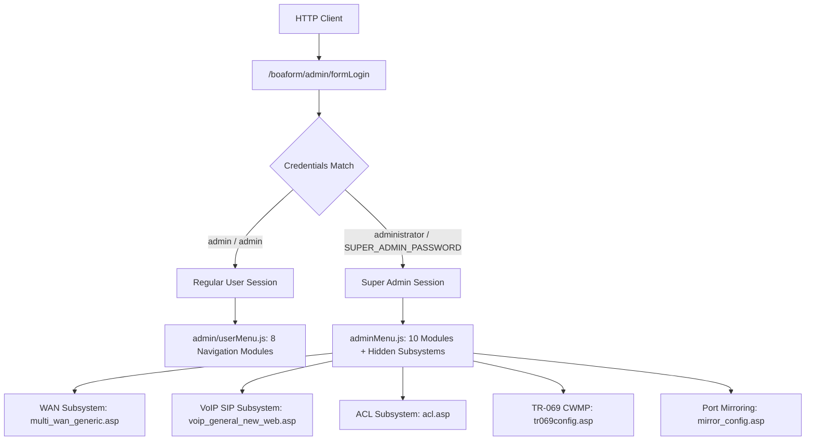

# Tenda HG7 Super Admin & Subsystems Technical Guide

An exhaustive technical deep dive into the ISP Super Administrator role (`administrator` / `<SUPER_ADMIN_PASSWORD>`) vs. the standard end-user role (`admin` / `admin`) on the Tenda HG7 GPON ONT router provisioned by Sri Lanka Telecom (SLT-MOBITEL) at [http://192.168.1.1](http://192.168.1.1).

## 1. Architectural Role Segregation

The embedded Boa 0.95.15 web server manages user privilege levels via local MIB table settings (`USER_NAME` vs `SUSER_NAME`). 

When an HTTP client authenticates against `/boaform/admin/formLogin`:
- **Regular User (`admin`)**: Boa binds the client session IP to `userMenu.js`. The dashboard exposes 8 basic navigation sections.
- **Super Administrator (`administrator`)**: Boa binds the client session IP to `adminMenu.js`. The dashboard unlocks 10 navigation sections, introducing **WAN** (Sub 4) and **VoIP** (Sub 6), along with low-level administrative utilities.



## 2. Unlocked Subsystems in Super Admin Mode

### 2.1 Multi-WAN Architecture (`multi_wan_generic.asp`)
Normal users cannot see or modify WAN profiles. The Super Admin interface exposes the complete ATM/PTM Virtual Circuit (VC) table:

1. **VLAN 20 (`ppp0_nas0_0`)**:
   - Connection Type: `INTERNET_TR069`
   - Protocol: `PPPoE`
   - Assigned Credentials: `<YOUR_SLT_USER_ID>@sltbbv6`
   - MTU: `1492`
   - Addressing: Dual-Stack (IPv4 CGNAT + IPv6 Prefix Delegation `/64`)
2. **VLAN 10 (`nas0_1`)**:
   - Connection Type: `VOICE`
   - Protocol: `IPoE`
   - Subnet: Dedicated private SLT Voice subnet (`29.178.1.0/24`)
3. **VLAN 30 (`nas0_2`)**:
   - Connection Type: `Other`
   - Protocol: `Bridged`
   - Purpose: PeoTV IPTV multicast stream bridging.

### 2.2 Landline VoIP Telephony (`voip_general_new_web.asp`)
The router includes an RJ-11 FXS physical port that terminates an analog telephone into SLT's IP Multimedia Subsystem (IMS):
- **Subscriber Number**: `+9411XXXXXXX` (Landline: `011XXXXXXX`)
- **SIP Domain**: `sltims.lk`
- **SIP Registrar & Proxy**: `ftth.sltims.lk:5060`
- **RTP Media Port**: `5000`
- **Supported Codecs**: G.711a, G.711u, G.729
- **DTMF Mode**: RFC 2833 (Payload Type: `96`)

### 2.3 Access Control Lists (`acl.asp`)
Controls which management daemons listen on LAN vs. WAN interfaces:
- **LAN Rule**: Unrestricted access for `ftp`, `web` (80), `https` (443), `snmp` (161/162), and `ping`.
- **WAN Rule**: SLT central maintenance IP block `222.165.185.1 - 222.165.185.6` has direct remote management access to `web` (HTTP port 80) and `ping` (ICMP echo) over the fiber link.

### 2.4 TR-069 CWMP Engine (`tr069config.asp`)
The router runs an embedded TR-069 CPE client that communicates with SLT's central Auto-Configuration Server (ACS):
- **ACS URL**: `http://acs.slt.lk`
- **ACS Username**: `acs@slt`
- **Periodic Inform Interval**: `10800` seconds (every 3 hours)
- **Connection Request Path**: `/tr069` on port `7547`

### 2.5 Port Mirroring (`mirror_config.asp`)
Allows forwarding ingress and egress frames from any internal LAN port (Ports 1–4) or wireless BSSID to a dedicated monitor port for Wireshark packet capture.

## 3. CLI & MCP Tool Usage for Super Admin

### Using `tenda-ctl`
Pass the `--super` flag (or set `TENDA_SUPER_PASSWORD` in your environment) to unlock these subsystems:

```bash
# View active WAN profiles
tenda-ctl wan --super

# View VoIP SIP configuration
tenda-ctl voip --super

# View Access Control Lists
tenda-ctl acl --super

# View TR-069 ACS telemetry
tenda-ctl tr069 --super
```

### Using Model Context Protocol (MCP)
Autonomous agents can query the following tools:
- `tenda_get_wan_profiles()`
- `tenda_get_voip_config()`
- `tenda_get_acl_rules()`
- `tenda_get_tr069_config()`
